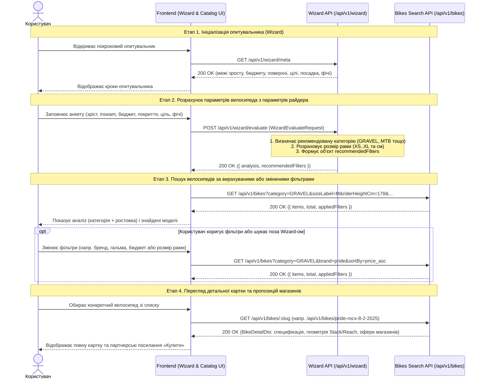
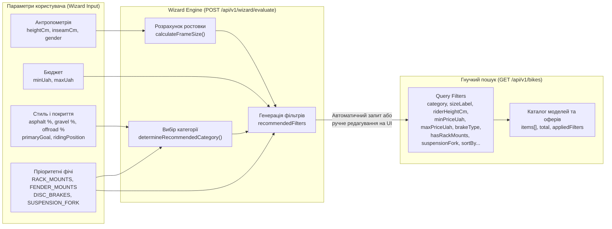

# VeloDruh Backend — Документація API-контрактів (`api.md`)

Документація REST API сервісу **VeloDruh** для взаємодії з покроковим опитувальником (**Smart Matching Wizard**) та гнучким пошуком по каталогу велосипедів.

- **Базовий URL**: `http://localhost:3000`
- **Префікс версії API**: `/api/v1`
- **Інтерактивна документація (Swagger UI)**: `GET /api-docs`
- **OpenAPI 3.1.0 JSON специфікація**: `GET /api-docs.json`

---

## 1. Діаграми взаємодії та потоків даних (Mermaid)

### 1.1. Sequence-діаграма: Флоу опитувальника (Wizard) та гнучкого пошуку велосипедів



---

### 1.2. Трансформація параметрів користувача у фільтри каталогу



---

## 2. Зведена таблиця ендпоінтів

| Метод | Шлях | Призначення |
|---|---|---|
| `GET` | `/health` | Перевірка працездатності сервісу (`Liveness check`) |
| `GET` | `/api-docs` | Інтерактивний інтерфейс Swagger UI |
| `GET` | `/api-docs.json` | Сира специфікація OpenAPI 3.1.0 у форматі JSON |
| `GET` | `/api/v1/wizard/meta` | Метадані, ліміти та довідники опцій для кроків опитувальника |
| `POST` | `/api/v1/wizard/evaluate` | Аналіз анкети користувача та розрахунок параметрів велосипеда (`recommendedFilters`) |
| `GET` | `/api/v1/bikes` | Пошук та сортування велосипедів за гнучкими query-фільтрами |
| `GET` | `/api/v1/bikes/:slug` | Повна специфікація моделі, геометрія рами та пропозиції партнерських магазинів |

---

## 3. Детальний опис контрактів та приклади Request – Response

### 3.1. Отримання метаданих опитувальника — `GET /api/v1/wizard/meta`

Повертає допустимі межі числових полів та довідники для кроків Wizard-а, щоб фронтенд не хардкодив бізнес-обмеження.

#### Request
```http
GET /api/v1/wizard/meta HTTP/1.1
Host: localhost:3000
Accept: application/json
```

#### Response (`200 OK`)
```json
{
  "heightRange": { "min": 140, "max": 215, "unit": "cm" },
  "inseamRange": { "min": 60, "max": 110, "unit": "cm" },
  "budgetLimits": {
    "min": 10000,
    "max": 200000,
    "defaultMin": 25000,
    "defaultMax": 55000,
    "currency": "UAH"
  },
  "ridingSurfaces": [
    { "id": "asphalt", "label": "Асфальт і місто", "icon": "road" },
    { "id": "gravel", "label": "Гравій і ґрунтові стежки", "icon": "gravel" },
    { "id": "offroad", "label": "Лісове бездоріжжя / гори", "icon": "mountain" }
  ],
  "ridingGoals": [
    { "id": "commuting", "label": "Щоденні поїздки на роботу / навчання" },
    { "id": "fitness", "label": "Спорт, фітнес і тренування" },
    { "id": "touring", "label": "Туризм і подорожі з баулами" },
    { "id": "recreation", "label": "Вихідні прогулянки в парку" }
  ],
  "ridingPositions": [
    { "id": "SPORT", "label": "Спортивна (аеродинамічна)" },
    { "id": "COMFORTABLE", "label": "Збалансована (комфортна)" },
    { "id": "UPRIGHT", "label": "Вертикальна (оглядова)" }
  ],
  "availableFeatures": [
    { "id": "RACK_MOUNTS", "label": "Кріплення для багажника" },
    { "id": "FENDER_MOUNTS", "label": "Кріплення для повнорозмірних крил" },
    { "id": "DISC_BRAKES", "label": "Дискові гальма" },
    { "id": "HYDRAULIC_BRAKES", "label": "Гідравлічні гальма" },
    { "id": "SUSPENSION_FORK", "label": "Амортизаційна вилка" }
  ]
}
```

---

### 3.2. Оцінка анкети та розрахунок параметрів велосипеда — `POST /api/v1/wizard/evaluate`

Приймає параметри користувача, обчислює рекомендовану категорію велосипеда і розмір рами (`analysis`), а також повертає готові фільтри велосипеда (`recommendedFilters`) для подальшого виклику `GET /api/v1/bikes`.

#### Правила валідації вхідного тіла (`WizardEvaluateRequest`)
- `rider.heightCm`: ціле число `140..215` (обов'язкове).
- `rider.inseamCm`: ціле число `60..110` (опціональне; якщо передано — точність розрахунку ростовки `confidence = "HIGH"`, інакше `"MEDIUM"`).
- `rider.gender`: `"UNISEX"` | `"MALE"` | `"FEMALE"` (за замовчуванням `"UNISEX"`).
- `budget.minUah`, `budget.maxUah`: цілі числа `5000..300000`, причому `maxUah >= minUah`.
- `usage.surfaceProportions`: сума `asphalt + gravel + offroad` має дорівнювати **`100`**.
- `usage.ridingPosition`: `"SPORT"` | `"COMFORTABLE"` | `"UPRIGHT"`.
- `usage.primaryGoal`: `"commuting"` | `"fitness"` | `"touring"` | `"recreation"`.
- `usage.featuresRequired`: масив значень із `["RACK_MOUNTS", "FENDER_MOUNTS", "DISC_BRAKES", "HYDRAULIC_BRAKES", "SUSPENSION_FORK"]`.

#### Request
```http
POST /api/v1/wizard/evaluate HTTP/1.1
Host: localhost:3000
Content-Type: application/json
```
```json
{
  "rider": {
    "heightCm": 178,
    "inseamCm": 83,
    "gender": "UNISEX"
  },
  "budget": {
    "minUah": 25000,
    "maxUah": 45000
  },
  "usage": {
    "surfaceProportions": {
      "asphalt": 60,
      "gravel": 30,
      "offroad": 10
    },
    "ridingPosition": "COMFORTABLE",
    "primaryGoal": "commuting",
    "featuresRequired": ["RACK_MOUNTS", "DISC_BRAKES"]
  }
}
```

#### Response (`200 OK`)
```json
{
  "analysis": {
    "recommendedCategory": {
      "type": "GRAVEL",
      "displayName": "Гравійний велосипед (Gravel)",
      "reasoning": "Ваш баланс 60% асфальту та 30% гравію ідеально покривається гравійником: жорстка вилка дає накат, а ширші покришки забезпечують комфорт поза містом."
    },
    "calculatedFrameSize": {
      "standardLabel": "M",
      "numericSize": 54,
      "unit": "cm",
      "confidence": "HIGH",
      "sizeAdvice": "Для зросту 178 см та довжини ноги (inseam) 83 см розмір M (54 см) забезпечить правильний стендовер і баланс керованості."
    }
  },
  "recommendedFilters": {
    "category": "GRAVEL",
    "sizeLabel": "M",
    "riderHeightCm": 178,
    "gender": "UNISEX",
    "minPriceUah": 25000,
    "maxPriceUah": 45000,
    "ridingPosition": "COMFORTABLE",
    "brakeTypes": ["HYDRAULIC_DISC", "MECHANICAL_DISC"],
    "hasRackMounts": true,
    "suspensionFork": false,
    "inStockOnly": true
  }
}
```

#### Response при помилці валідації (`400 Bad Request`)
```json
{
  "error": "Request validation failed",
  "code": "VALIDATION_ERROR",
  "details": [
    {
      "path": "usage.surfaceProportions.asphalt",
      "message": "Surface proportions (asphalt + gravel + offroad) must sum to 100"
    }
  ]
}
```

---

### 3.3. Гнучкий пошук велосипедів — `GET /api/v1/bikes`

Використовується як для відображення результатів одразу після проходження Wizard-а (підставляючи `recommendedFilters`), так і для вільного пошуку та зміни параметрів у каталозі.

#### Доступні Query-параметри (`req.query`)

| Параметр | Тип | Допустимі значення / Формат | Опис |
|---|---|---|---|
| `category` | `string` | `GRAVEL`, `ROAD`, `MTB_HARDTAIL`, `CITY_COMMUTER`, `TOURING`, `HYBRID` | Категорія велосипеда |
| `brand` | `string` | Напр. `pride`, `merida`, `trek`, `kellys`, `cannondale` | Slug або назва бренду (регістронезалежно) |
| `sizeLabel` | `string` | `XS`, `S`, `M`, `L`, `XL` | Розмірна мітка рами |
| `riderHeightCm` | `integer` | `140..215` | Зріст райдера у см (шукає моделі з варіантами рами під цей зріст) |
| `gender` | `string` | `UNISEX`, `MALE`, `FEMALE` | Цільова стать (включає `UNISEX` моделі) |
| `minPriceUah` | `integer` | `>= 0` | Мінімальна ціна в грн |
| `maxPriceUah` | `integer` | `> 0` | Максимальна ціна в грн |
| `brakeType` | `string` | `HYDRAULIC_DISC`, `MECHANICAL_DISC`, `RIM` (можна через кому) | Тип гальм (напр. `HYDRAULIC_DISC,MECHANICAL_DISC`) |
| `frameMaterial` | `string` | `ALUMINUM`, `CARBON`, `STEEL` | Матеріал рами |
| `ridingPosition` | `string` | `SPORT`, `COMFORTABLE`, `UPRIGHT` | Тип посадки |
| `wheelSize` | `string` | Напр. `28"`, `29"` | Діаметр коліс |
| `hasRackMounts` | `boolean` | `true` / `false` | Наявність бонок під багажник |
| `hasFenderMounts` | `boolean` | `true` / `false` | Наявність кріплень під повнорозмірні крила |
| `suspensionFork` | `boolean` | `true` / `false` | Наявність амортизаційної вилки |
| `maxWeightKg` | `number` | `> 0` (напр. `12.5`) | Максимальна вага велосипеда у кг |
| `inStockOnly` | `boolean` | `true` / `false` | Тільки моделі з пропозиціями в наявності |
| `sortBy` | `string` | `price_asc` (дефолт), `price_desc`, `weight_asc`, `year_desc` | Поле та напрямок сортування |

#### Request
```http
GET /api/v1/bikes?category=GRAVEL&sizeLabel=M&riderHeightCm=178&minPriceUah=25000&maxPriceUah=45000&brakeType=HYDRAULIC_DISC,MECHANICAL_DISC&hasRackMounts=true&suspensionFork=false&inStockOnly=true&sortBy=price_asc HTTP/1.1
Host: localhost:3000
Accept: application/json
```

#### Response (`200 OK`)
```json
{
  "items": [
    {
      "slug": "pride-rocx-8-2-2025",
      "name": "Pride Rocx 8.2",
      "brand": {
        "slug": "pride",
        "name": "Pride",
        "logoUrl": "https://velodruh.ua/assets/brands/pride.svg",
        "country": "Ukraine"
      },
      "category": "GRAVEL",
      "modelYear": 2025,
      "description": "Універсальний гравійний велосипед українського бренду Pride на алюмінієвій рамі з великою кількістю бонок для байкпакінгу та щоденного ком’ютингу.",
      "gender": "UNISEX",
      "specs": {
        "brakeType": "MECHANICAL_DISC",
        "drivetrain": "Shimano Sora 2x9",
        "wheelSize": "28\"",
        "weightKg": 11.4,
        "frameMaterial": "ALUMINUM",
        "ridingPosition": "COMFORTABLE",
        "hasRackMounts": true,
        "hasFenderMounts": true,
        "suspensionFork": false
      },
      "surfaceProfile": {
        "asphaltScore": 80,
        "gravelScore": 90,
        "offroadScore": 45
      },
      "imageUrl": "https://velodruh.ua/assets/bikes/pride-rocx-8-2.jpg",
      "keyHighlights": [
        "Трансмісія Shimano Sora 2x9 — надійна для ком’ютингу та гравію",
        "Механічні дискові гальма TRP Spyre C з подвійним підведенням колодок",
        "Бонки на вилці та рамі для багажника, крил і турингових сумок"
      ],
      "bestPriceUah": 33900,
      "variants": [
        {
          "sizeLabel": "M",
          "numericSizeCm": 54,
          "minRiderHeightCm": 170,
          "maxRiderHeightCm": 182,
          "minInseamCm": 78,
          "maxInseamCm": 86,
          "stackMm": 575,
          "reachMm": 385,
          "offers": [
            {
              "shopName": "Velogo",
              "shopSlug": "velogo",
              "priceUah": 33900,
              "oldPriceUah": 36500,
              "inStock": true,
              "productUrl": "https://velogo.com.ua/ua/pride-rocx-8-2",
              "affiliateUrl": "https://velodruh.ua/go/velogo/pride-rocx-8-2?size=M",
              "lastCheckedAt": "2026-10-27T08:00:00Z"
            },
            {
              "shopName": "Велопланета",
              "shopSlug": "veloplaneta",
              "priceUah": 34200,
              "oldPriceUah": null,
              "inStock": true,
              "productUrl": "https://veloplaneta.ua/ua/pride-rocx-8-2",
              "affiliateUrl": "https://velodruh.ua/go/veloplaneta/pride-rocx-8-2?size=M",
              "lastCheckedAt": "2026-10-27T08:00:00Z"
            }
          ]
        }
      ]
    }
  ],
  "total": 1,
  "appliedFilters": {
    "category": "GRAVEL",
    "sizeLabel": "M",
    "riderHeightCm": 178,
    "minPriceUah": 25000,
    "maxPriceUah": 45000,
    "brakeType": ["HYDRAULIC_DISC", "MECHANICAL_DISC"],
    "hasRackMounts": true,
    "suspensionFork": false,
    "inStockOnly": true,
    "sortBy": "price_asc"
  }
}
```

---

### 3.4. Детальна картка моделі — `GET /api/v1/bikes/:slug`

Повертає повні технічні характеристики конкретної моделі, геометрію всіх розмірів рами (`stackMm`, `reachMm`) та пропозиції всіх партнерських магазинів.

#### Request
```http
GET /api/v1/bikes/pride-rocx-8-2-2025 HTTP/1.1
Host: localhost:3000
Accept: application/json
```

#### Response (`200 OK`)
Повертає повний об'єкт `BikeDetailDto` (аналогічний елементу масиву `items` вище, з усіма ростовками `S`, `M`, `L` та оферами кожного магазину).

#### Response якщо модель не знайдено (`404 Not Found`)
```json
{
  "error": "Bike with slug \"unknown-bike\" not found",
  "code": "NOT_FOUND"
}
```

